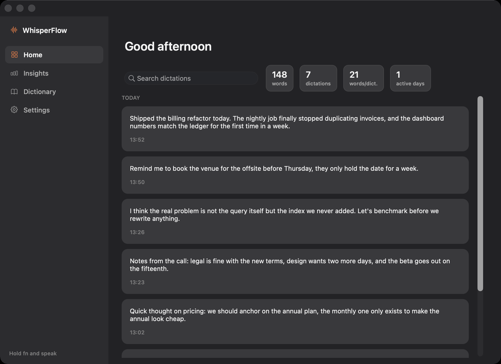
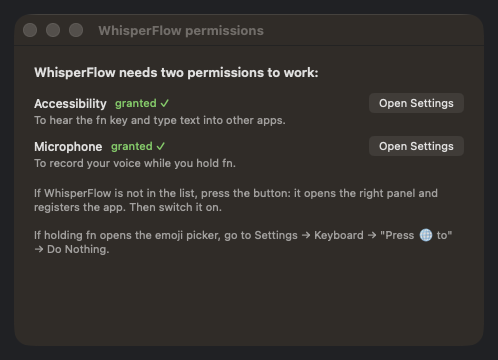
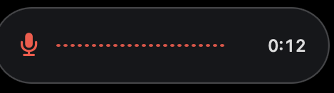
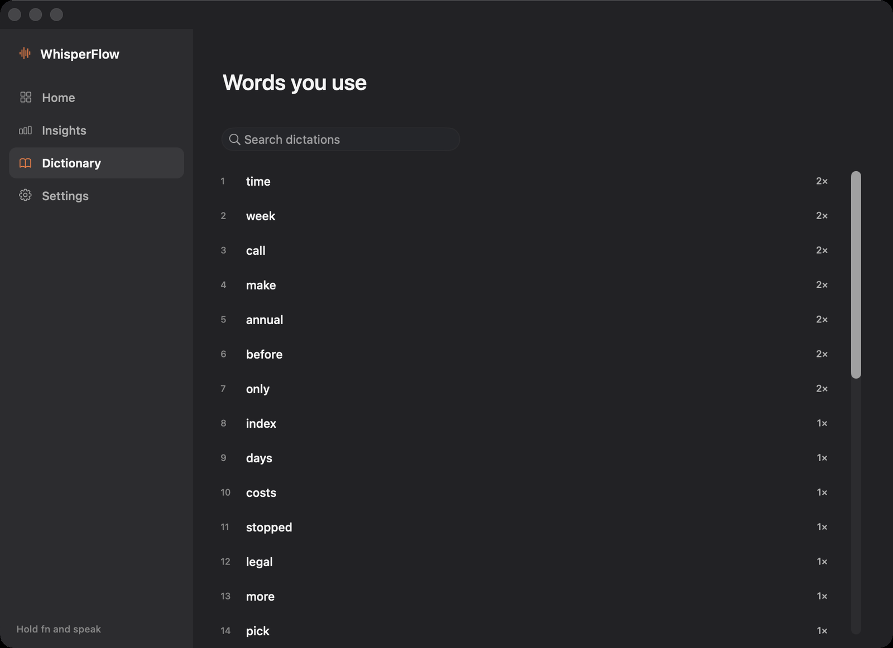

# WhisperFlow

Free, **100% local** voice dictation for macOS. Hold the `fn` key, speak, release —
and the text appears in whatever app has the cursor.

A minimalist clone of Wispr Flow with no subscription: your audio never leaves your
Mac, there is no account, there is no cloud.



```
hold fn ──► record ──► local whisper.cpp ──► [optional cleanup] ──► type the text
                                                              └──► panel (if it fails)
```

## What's in here

| File | What it does |
|---|---|
| `Sources/FnKeyMonitor.swift` | Watches `fn` through a low-level event tap and swallows it so macOS doesn't open the emoji picker. Any other key while `fn` is held cancels. |
| `Sources/AudioRecorder.swift` | `AVAudioEngine` (a fresh one per recording) → in-memory samples → 16-bit mono WAV. |
| `Sources/Transcriber.swift` | `ffmpeg` to 16 kHz + `whisper-cli` + hallucination cleanup. Hard timeouts. |
| `Sources/TextInserter.swift` | Pastes with a single atomic ⌘V (it cannot arrive half-written) and verifies through Accessibility only when that data is trustworthy. |
| `Sources/RulesCleaner.swift` | Instant cleanup: drops fillers, fixes spacing, capitalisation and the final period. |
| `Sources/LlamaEngine.swift` | Cleanup with a local LLM (llama.cpp + Metal). |
| `Sources/PostProcessor.swift` | Cleanup chain: Apple Intelligence → llama.cpp → raw text, with guard rails. |
| `Sources/MainWindow.swift` | The main app window: sidebar, dictations grouped by day, stats, search. |
| `Sources/DictationCardView.swift` | One dictation card: large readable text, timestamp, copy actions. |
| `Sources/TranscriptPanel.swift` | Floating history panel that never steals focus. |
| `Sources/Clipboard.swift` | Single owner of the system clipboard (prevents the "restore stole my copy" race). |
| `Sources/TranscriptStore.swift` | Persistent JSON history (50 entries). |
| `Sources/OverlayHUD.swift` | The floating pill with a real audio level meter. |
| `Sources/Diagnostics.swift` | Log at `~/Library/Application Support/WhisperFlow/whisperflow.log`. |
| `Sources/AppDelegate.swift` | Menu bar icon, states, permissions, menu. |

## Requirements

None of this installs itself, and there is **no Ollama, no daemon, no cloud**:
everything runs on native binaries.

| What | Why | How to get it | Size |
|---|---|---|---|
| macOS 13+ (Apple Silicon recommended) | OS | — | — |
| Xcode Command Line Tools | `swiftc`, to build the app | `xcode-select --install` | ~1 GB |
| `ffmpeg` | Resample audio to 16 kHz mono | `brew install ffmpeg` | ~80 MB |
| Portable cmake | Build whisper.cpp | `scripts/bootstrap.sh` | ~75 MB |
| whisper.cpp (`whisper-cli`) | Transcribe | `scripts/bootstrap.sh` | ~83 MB |
| `ggml-large-v3-turbo-q5_0.bin` | Speech model | `scripts/bootstrap.sh` | 547 MB |
| llama.cpp (`llama-completion`) | AI cleanup — optional | `scripts/bootstrap.sh` | ~40 MB |
| `Qwen2.5-3B-Instruct-Q4_K_M.gguf` | AI cleanup — optional | `scripts/bootstrap.sh` | 1.8 GB |

**~2.6 GB** with AI cleanup, **~800 MB** without it.

> **About Ollama:** it is not used anywhere. The cleanup runtime is `llama.cpp`
> (official binary with Metal) and the model is a plain `.gguf` passed as an
> argument. Ollama would add a daemon, a port and an HTTP client to do the same job.

### Quick start

```bash
git clone https://github.com/xStaked/whisper-flow.git
cd whisper-flow
./scripts/bootstrap.sh          # builds whisper.cpp, downloads models, packages the app
open build/WhisperFlow.app
```

The script is idempotent: anything already downloaded or built is skipped.

## Build

```bash
./build.sh
open build/WhisperFlow.app
```

`build.sh` compiles the Swift bundle, copies `whisper-cli` into the app and signs it
with your **Apple Development** certificate when one exists (that's what makes the
macOS permissions survive rebuilds).

Things we learned from using this daily:

- Signing has a **20 s timeout**. With a locked keychain, `codesign` waits forever
  behind an invisible prompt and the build never finishes.
- If certificate signing fails it falls back to **ad-hoc** so the app still runs.
  Careful: that **wipes the Accessibility permission** and you have to grant it
  again. Unlock your keychain before rebuilding if you want to keep it.
- Don't rebuild while the app is running: `codesign` hangs on a bundle in use.

Models:

```bash
./download-model.sh                                        # speech, ~547 MB
curl -L -o models/Qwen2.5-3B-Instruct-Q4_K_M.gguf \
  https://huggingface.co/bartowski/Qwen2.5-3B-Instruct-GGUF/resolve/main/Qwen2.5-3B-Instruct-Q4_K_M.gguf   # AI cleanup, ~1.8 GB
```

## Launch at login

```bash
./scripts/install-login-item.sh          # start at login
./scripts/install-login-item.sh --remove # uninstall
```

It creates `~/Library/LaunchAgents/com.local.whisperflow.plist`, which launches the
app with `open -g` — **not** the raw binary: running `Contents/MacOS/WhisperFlow`
directly leaves the process alive but `NSApplication` never initialises, so the
hotkey is never installed.

macOS lists it in Settings → General → Login Items & Extensions.

## Permissions (one time only)

1. **Microphone** → allow.
2. **Accessibility** (Settings → Privacy & Security → Accessibility) → enable
   *WhisperFlow*. Without it the app can neither hear `fn` nor type text.

If holding `fn` opens the emoji picker:
**Settings → Keyboard → "Press 🌐 to" → Do Nothing**.

The app ships a permissions window that updates live and closes itself once both
are granted:



## Usage

- **Hold `fn`** and speak. On release it transcribes and types.
- **Click** the icon → the main window.
- **Right click** → menu: text cleanup, permissions, log, data folder, quit.

Icon: microphone = idle · red = recording · orange = transcribing.

## On-screen indicator

While dictating, a pill appears at the bottom centre (100 px above the Dock):



- **The waveform is your real voice**, not decoration: it measures RMS in dBFS with
  adaptive gain, so it responds the same with AirPods, the built-in mic or a USB
  one, and you don't have to shout to move it.
- **A timer**, useful for long dictations and to see the 120 s cutoff coming.
- On release it switches to `transcribing…`, then `✓ inserted` (or `check the panel`)
  and disappears on its own.
- It is **click-through and non-activating**: clicks pass through and it never
  steals focus, so the text always lands in the right app. Works fullscreen and
  across Spaces.
- Turn it off in **right click → On-screen indicator** (or `showOverlay: false`).

## The main window

Clicking the menu icon opens **the full app**, not a pill:

- **Home**: dictations grouped by day (Today / Yesterday / date), with stats.
- **Insights**: word totals, dictation count and average.
- **Dictionary**: the words you use most across your dictations.


- **Search**: filters as you type, no waiting.
- Every card: selectable text, copy with one click or ⌘C.

## Where your text lives

Everything lives in one folder, outside the repo:

```
~/Library/Application Support/WhisperFlow/
├── history.json        # the last 50 dictations (text + date)
├── config.json         # settings
└── whisperflow.log     # diagnostics
```

- **Click the icon** → *History* panel: each dictation is a card with its own
  **Copy** button, the text is selectable (⌘C works too) and there is a
  **Copy all** button.
- **Export** saves everything as dated Markdown, for archiving or versioning.
- **Right click → Open data folder** opens those files in Finder.
- The history holds the last 50 entries; it never grows without bound.

> The clipboard belongs to the system: if you copy something from the history and
> then paste anywhere, that is exactly what appears. No other part of the app
> overwrites it.

## Text cleanup (optional)

Right click → **Text cleanup**:

| Mode | Latency | What it does |
|---|---|---|
| Off | 0 | Raw Whisper output (it already includes punctuation). |
| **Rules** | ~0 ms | Drops `eh/um/mmm`, fixes spacing and capitalisation, adds the final period. Never changes meaning. |
| **Local AI** | +4-5 s | Local LLM: rewrites punctuation, drops filler words, splits sentences. Keeps numbers and technical vocabulary. |

The AI is skipped for dictations shorter than `postProcessMinWords` words (12 by
default): on short commands latency matters more than polish.

Tested with `Qwen2.5-3B-Instruct-Q4_K_M`. To swap it, point `llmModelPath` at
another `.gguf` and restart.

> **Why not Apple Intelligence:** on macOS 26 the `FoundationModels` framework
> exists, but on this machine the on-device model is disabled
> (`appleIntelligenceNotEnabled`) and it isn't available in the region. The code
> tries it first and uses it when present (it's faster than llama.cpp); otherwise
> it falls back to llama.cpp.

## Configuration

`~/Library/Application Support/WhisperFlow/config.json`

| Key | Default | Notes |
|---|---|---|
| `language` | `"en"` | `"en"`, `"es"` or `"auto"`. `auto` costs ~1.5 s extra. |
| `modelPath` | `models/ggml-large-v3-turbo-q5_0.bin` | Speech model. |
| `postProcess` | `false` | Cleanup switch (the menu toggles it live). |
| `postProcessEngine` | `"rules"` | `"rules"` or `"llm"`. |
| `postProcessMinWords` | `12` | Minimum words before the AI runs. |
| `showOverlay` | `true` | Floating indicator on screen. |
| `llmModelPath` | `models/Qwen2.5-3B-Instruct-Q4_K_M.gguf` | Cleanup model. |
| `llmBinaryPath` | `vendor-llama/*/llama-completion` | llama.cpp runtime. |
| `maxRecordSeconds` | `120` | Stops on its own if you forget to release. |
| `soundsEnabled` | `true` | Tink on start, Pop on finish. |
| `autoInsert` | `true` | When `false`, only fills the panel. |

## Measured performance (M4 Pro)

| Stage | Memory | Time |
|---|---|---|
| App at rest | 21 MB | ~0% CPU |
| Transcription (`whisper-cli`) | 832 MB peak, then released | 2 s (23 s audio) · 7 s (46 s audio) |
| "Rules" cleanup | negligible | <10 ms |
| "Local AI" cleanup | ~2.5 GB peak, then released | ~4.5 s |

The speech model is not kept resident: it is loaded and released on every
dictation. That's why idle memory is 21 MB instead of 900 MB.

## When automatic insertion doesn't work

- Fields with **secure input** (passwords, some banks) — macOS blocks it.
- Electron/web apps that ignore Unicode events → the ⌘V fallback covers it.
- If that fails too, the text is **copied to the clipboard** and the pill says
  `copied to clipboard` with a teal icon. No window opens: a popup would activate
  WhisperFlow, and the next dictation would land inside it instead of your app.

## Development

The hotkey lives in a low-level `CGEventTap`. Golden rule: **never do heavy work
inside the callback** — if it takes more than ~1 s, macOS disables the tap
(`tapDisabledByTimeout`) and the shortcut stays dead until restart. That's why
everything is dispatched to the main queue, and why a watchdog reinstalls the tap
every 15 s.

```bash
./build.sh                    # build and sign
open build/WhisperFlow.app    # run
tail -f ~/Library/Application\ Support/WhisperFlow/whisperflow.log   # diagnostics
```

Useful flags for development:

```bash
./build/WhisperFlow.app/Contents/MacOS/WhisperFlow --show-window          # open the main window
./build/WhisperFlow.app/Contents/MacOS/WhisperFlow --show-window --section dictionary
./build/WhisperFlow.app/Contents/MacOS/WhisperFlow --demo-hud            # show the recording pill
./build/WhisperFlow.app/Contents/MacOS/WhisperFlow --demo-setup          # show the permission window
WHISPERFLOW_HUD_SCREEN=0 ./build/WhisperFlow.app/Contents/MacOS/WhisperFlow --demo-hud   # force a screen
```

The screenshots in `docs/images/` were taken with those flags, so they can be
regenerated after a UI change.

> Screenshots show demo content. Your dictations live in
> `~/Library/Application Support/WhisperFlow/history.json` and are never part of
> the repo.

## Uninstall

```bash
rm -rf ~/Library/Application\ Support/WhisperFlow
rm -rf build/WhisperFlow.app
```

And remove the Accessibility permission in Settings.
